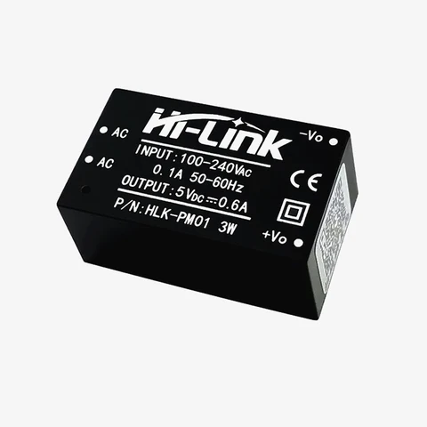

# Базова платка (Base board) — спецификация

> Чернова. Целта е да се предвиди място за всички необходими елементи; незадължителните позиции
> могат да останат незапоени (DNP), ако не се окажат нужни.

Платката носи модула **Waveshare ESP32-S3-Zero** и съдържа клемите, захранващия модул
**Hi-Link HLK-PM01** (230 V AC → 5 V DC), релето за помпата и входовете за температурните датчици.

## 1. Кутия и клеми

**Кутия:** стандартна кутия за DIN шина, ширина **2 модула (35 mm)**.
Ориентир за вътрешната ширина на платката: ~ 33 – 34 mm (уточнява се по конкретната кутия).
Клемите са в два реда — 230 V от едната страна, ниско напрежение (датчици) от другата.

Примерна кутия, чиито изводи следваме (описание):
- Кутия за DIN шина, 2 модула, с по един ред от **6 винтови клеми** отгоре и отдолу.
- Над всеки ред има табелка със символи и номерата на клемите.
- Ред 230 V — клеми **1 – 6**: реле за нагревател (1, 2), реле за помпа (3, 4), L (5), N (6), надпис „230V~“
  (в нашия проект разпределението е променено — виж т. 1.1).
- Ред ниско напрежение — клеми **10 – 15**: по двойка клеми (+/−) за датчик в колектора (символ слънце) и
  за два датчика в бойлера (символ на бойлер със серпентина).

### 1.1 Клеми 230 V (ред 1 – 6)

Собствено разпределение (различно от примерната кутия — без реле за нагревател):

| Клема | Сигнал | Функция |
|---|---|---|
| 1 | N | Захранване — нула, вход 230 V AC |
| 2 | N | Извод за помпата — нула (свързана с клема 1 на платката) |
| 3 | L | Захранване — фаза, вход 230 V AC (през F1 към общия контакт на релето и през F2 към HLK-PM01) |
| 4 | L ⏵ | Изход за помпата — нормално отворен контакт (NO) на релето |
| 5 | L ⏴ | Нормално затворен контакт (NC) на релето — под напрежение, когато помпата е изключена |
| 6 | — | Свободна (не се използва) |

Свързване на помпата: **4 (L) и 2 (N)**. Клема 5 е за евентуален друг консуматор/сигнализация,
който трябва да работи, когато помпата е спряна; ако не е нужна — остава незасвързана.

Защитният проводник (PE) не минава през контролера — свързва се директно към помпата в разпределителната кутия.

### 1.2 Клеми за датчиците (ред 10 – 15)

Примерната кутия има по 2 клеми на датчик (за NTC/PT1000) за 3 датчика. DS18B20 изисква **3 жила**,
затова същите 6 клеми се разпределят за **2 датчика × 3 клеми**:

| Клема | Сигнал | Датчик |
|---|---|---|
| 10 | +5V (червено) | T_COL — колектор |
| 11 | DATA (жълто) | T_COL — колектор |
| 12 | GND (черно) | T_COL — колектор |
| 13 | +5V (червено) | T_TANK — бойлер |
| 14 | DATA (жълто) | T_TANK — бойлер |
| 15 | GND (черно) | T_TANK — бойлер |

**Решение: броят на датчиците е фиксиран на 2** (колектор и бойлер) — трети няма да има.

## 2. Блокова схема

```
 230 V AC ──► [3 L / 1 N] ──► [F1 предпазител] ──► [RV1 варистор] ──► [HLK-PM01] ──► [C 470 µF + 100 nF] ──► 5 V шина
                 │                                                                                         │
                 │                                            ┌────────────────────────────────────────────┼─────────────┐
                 │                                            ▼                                            ▼             ▼
                 │                                     ESP32-S3-Zero (5V)                          Бобина на релето   Филтър → 5V на датчиците
                 │                                            │ 3V3(OUT)
                 │                                            └──► pull-up резистори на 1-Wire линиите
                 │
                 └──► L ──► [общ контакт K1] ──► 4 (NO) ──► циркулационна помпа ──► 2 (N) ═ 1 (N)
                                              └─► 5 (NC)
```

## 3. Блокове и елементи

### 3.1 Мрежов вход 230 V AC

| Поз. | Елемент | Бележка |
|---|---|---|
| X1 | Клеми 1 – 6 (N, N, L, L-NO, L-NC, свободна) | стъпка 5.0 / 5.08 mm |
| F1 | Предпазител за веригата на помпата | според тока на помпата, напр. T 2 A |
| F2 | Предпазител за HLK-PM01 | T 200 – 315 mA (препоръчва се от производителя на модула) |
| RV1 | Варистор 275 V AC (напр. 07D471 / 10D471) | защита от пренапрежения |
| — | Изолационен процеп (слот) под HLK-PM01, под релето и между 230 V и ниско напрежение | ≥ 6 mm пътища (creepage) |

### 3.2 Захранване 5 V — Hi-Link HLK-PM01



| Параметър | Стойност |
|---|---|
| Вход | 100 – 240 V AC, 0.1 A, 50 – 60 Hz |
| Изход | **5 V DC, 0.6 A (3 W)** |
| Изводи | AC, AC / +Vo, −Vo |
| Изолация | вградена (изправител, импулсен преобразувател и стабилизация в модула) |

Изходни кондензатори:

| Поз. | Елемент | Бележка |
|---|---|---|
| C1 | **Електролитен 470 µF / 10 V** (low-ESR, 105 °C) | буфер при включване на релето и Wi-Fi пикове; допустимо 220 – 1000 µF |
| C2 | **Керамичен SMD 100 nF** (X7R, 0805) | ВЧ филтър, възможно най-близо до изводите на модула |
| C3 | Керамичен SMD 10 µF (X5R/X7R, 0805/1206) | по избор, между C1 и C2 |
| D1 | TVS диод 5 V (напр. SMBJ5.0A) | по избор, защита на 5 V шината |
| FB1 | Ферит в 5 V след кондензаторите | по избор, ако модулът е шумен |
| LED1 | Индикатор „Захранване“ + резистор | по избор |

Енергиен баланс от 5 V:

| Консуматор | Ток |
|---|---|
| ESP32-S3 с Wi-Fi (пикове) | до ~350 mA (средно ~100 mA) |
| Бобина на релето 5 V | ~70 – 90 mA |
| Вграден RGB светодиод WS2812 | до ~60 mA при пълна бяла яркост; ~5 – 20 mA при индикация |
| 2 × DS18B20 | ~3 mA |
| **Общо (пик)** | **~0.5 A** спрямо 0.6 A на HLK-PM01 |

Изводи: HLK-PM01 е достатъчен, но с малък резерв. Затова: яркостта на светодиода се ограничава във фърмуера,
а C1 поема краткотрайните Wi-Fi пикове.

### 3.3 Реле за циркулационната помпа

| Поз. | Елемент | Бележка |
|---|---|---|
| K1 | Реле 5 V, превключващ контакт (SPDT), ≥ 10 A / 250 V AC (напр. HF32F, SRD-05VDC-SL-C) | общ → L (клема 3), NO → клема 4, NC → клема 5 |
| Q1 | NPN транзистор (BC817 / MMBT2222A) или N-MOSFET (2N7002 / AO3400) | ключ в ниския край на бобината |
| R1 | Базов резистор ~1 kΩ (при MOSFET — ~100 Ω към гейта) | |
| R2 | Pull-down 10 – 100 kΩ на базата/гейта | релето е изключено при рестарт |
| D2 | Обратен диод (1N4148 / 1N4007 / SS14) паралелно на бобината | катод към +5 V |
| LED2 | Индикатор „Помпа включена“ + резистор | по избор |
| RC1 / RV2 | RC снъбер (100 Ω + 100 nF X2) или варистор на контакта | по избор, срещу искрене |

Ниското реле (напр. HF32F, височина ~ 10 mm) се събира по-лесно в DIN кутията.

### 3.4 Входове за температурните датчици (×2)

Еднакъв възел за всеки канал (T_COL, T_TANK):

| Поз. | Елемент | Бележка |
|---|---|---|
| X2 | Клеми 10 – 15 (виж т. 1.2), стъпка 5.0 mm | червено 5V / жълто DATA / черно GND |
| Rpu | Pull-up 4.7 kΩ от DATA към **3.3 V** | при конектора |
| Rs | Последователен резистор 100 – 220 Ω между DATA и GPIO | ограничава ток при повреда |
| Dcl | Двоен Шотки (BAT54S) към 3.3 V и GND или ESD диод | ограничава напрежението на GPIO |
| Rf / FBf | Ферит или резистор 10 – 47 Ω по 5 V към клемата | филтър |
| Cf | 100 nF между 5 V и GND при клемата | |
| PTC | Самовъзстановяващ се предпазител ~50 – 100 mA | по избор, може общ за двата канала |

### 3.5 Локално управление (дисплей и бутони)

| Поз. | Елемент | Бележка |
|---|---|---|
| SW1 – SW3 | 3 бутона на лицевия панел (към GND, pull-up към 3.3 V) | по избор 100 nF към GND |
| U2 | TM1637 + 3-цифрен 7-сегментен индикатор (общ анод) | на горната платка, видим през лицевия панел |
| R | 10 kΩ pull-up на CLK и DIO към **3.3 V** | TM1637 е на 5 V, без преобразувател на ниво |
| C | 100 pF на CLK и DIO към GND | по избор, срещу смущения (препоръка от datasheet-а) |
| C | 100 nF + 10 µF при VDD на TM1637 | |

## 4. Разпределение на изводите

Използват се само страничните изводи **GP1 – GP13** (на тях се запояват проводници);
малките пад-ове от долната страна (GP17, GP18, GP38 – GP42, GP45) не се използват.

| Функция | GPIO | Бележка |
|---|---|---|
| T_COL (колектор) | **GP1** | ляв ред, до 3V3 / GND |
| T_TANK (бойлер) | **GP2** | ляв ред |
| RELAY (помпа) | **GP4** | ляв ред; pull-down на базата/гейта държи релето изключено при старт |
| TM1637 CLK | **GP5** | ляв ред |
| TM1637 DIO | **GP6** | ляв ред |
| BTN1 (меню) | **GP7** | десен ред |
| BTN2 (−) | **GP8** | десен ред |
| BTN3 (+) | **GP9** | десен ред |
| Резерв | GP10 – GP13 | свободни |
| Вграден RGB светодиод (индикация) | GP21 | на платката ESP32-S3-Zero, използва се така, както е |
| BOOT | GP0 | бутон на платката |

Избягват се: **GP3** (strapping извод на ESP32-S3), GP0, GP45, GP46 (strapping), GP19/GP20 (USB), GP43/GP44 (UART0 конзола).

Датчиците, релето и дисплеят са в левия ред (до 5V / GND / 3V3); бутоните — в десния ред.

## 5. Конструктивни изисквания

- Ширина на платката според DIN кутията за 2 модула; при нужда — две платки една над друга
  (долна: 230 V, HLK-PM01, реле, клеми; горна: ESP32-S3-Zero, дисплей TM1637, 3 бутона).
- Вграденият светодиод на ESP32-S3-Zero трябва да се вижда отвън — прозорче/светловод в лицевия панел на кутията.
- Ясно разделяне на зоната 230 V от зоната с ниско напрежение; изолационни процепи под HLK-PM01 и под релето.
- Широки писти за веригата на помпата (клема 3 → F1 → контакт на релето → клема 4; клема 1 ↔ клема 2).
- Антената на ESP32-S3-Zero — към горната (лицевата) част на кутията, без мед под нея и далеч от релето и HLK-PM01.
- USB-C на ESP32-S3-Zero — по възможност достъпен за програмиране без разглобяване (или разчитаме на OTA).
