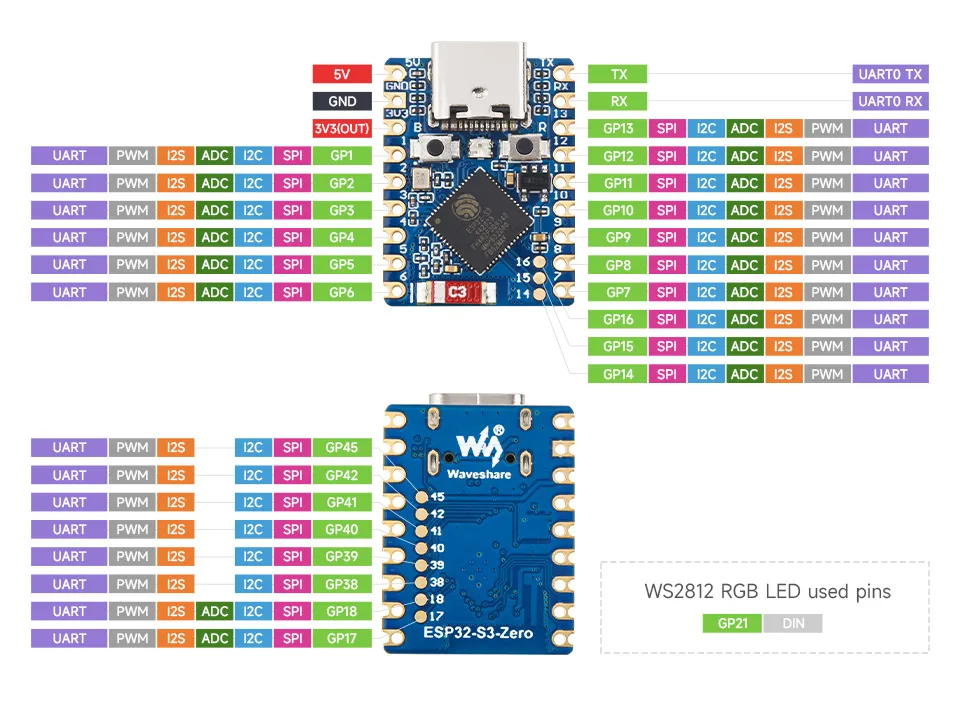

# Хардуерна спецификация

> Документът се допълва с напредването на хардуерната разработка (платка, датчици, изпълнителни елементи).

## 0. Обобщение

| Блок | Компонент | Захранване |
|---|---|---|
| Микроконтролер | Waveshare ESP32-S3-Zero | 5 V шина (вход 5V) |
| Индикация | RGB светодиод WS2812 (XL-0807RGBC-WS2812B) | 5 V шина |
| Изпълнителен елемент | Реле (5 V бобина) | 5 V шина |
| Температурни датчици | 2 × DS18B20 (водоустойчива сонда) | 3.3 V (препоръка, виж т. 3) |

## 1. Микроконтролерна платка — Waveshare ESP32-S3-Zero

> Потвърдено: чипът е **ESP32-S3** (платка ESP32-S3-Zero, както е на диаграмата).

- **Чип:** ESP32-S3 (Xtensa LX7, двуядрен, Wi-Fi 2.4 GHz + Bluetooth LE)
- **Конектор:** USB Type-C (захранване, програмиране, USB-Serial/JTAG)
- **Бутони:** `B` — BOOT (GPIO0), `R` — RESET
- **Вграден RGB светодиод:** WS2812 на **GPIO21** (DIN)

### Захранващи изводи

| Извод | Описание |
|---|---|
| 5V | Вход/изход 5 V (от USB) |
| GND | Маса |
| 3V3 (OUT) | Изход 3.3 V от вградения регулатор |

### GPIO извеждания

| Страна | Изводи | Функции (според pinout-а) |
|---|---|---|
| Лява (горе) | GP1 – GP6 | UART, PWM, I2S, **ADC**, I2C, SPI |
| Дясна (горе) | TX, RX | UART0 TX / RX (конзола) |
| Дясна (горе) | GP7 – GP13 | UART, PWM, I2S, **ADC**, I2C, SPI |
| Дясна (долу) | GP14 – GP16 | UART, PWM, I2S, **ADC**, I2C, SPI |
| Долна страна (пад) | GP17, GP18 | UART, PWM, I2S, **ADC**, I2C, SPI |
| Долна страна (пад) | GP38 – GP42, GP45 | UART, PWM, I2S, I2C, SPI (без ADC) |

Бележки:
- Аналогови входове (ADC) има само на GP1 – GP18 — важно за датчици за температура (NTC и др.).
- GP0 е BOOT бутонът; GP21 е зает от вградения RGB светодиод.
- GP45 е strapping извод на ESP32-S3 (избор на напрежение на VDD_SPI) — да се използва внимателно.
- GP19/GP20 са USB D-/D+ и не са изведени.
- Изводите GP17, GP18, GP38–GP42, GP45 са пад-ове от долната страна на платката.

## 2. Вграден RGB светодиод — XINGLIGHT XL-0807RGBC-WS2812B

Datasheet: [`XL-0807RGBC-WS2812B.pdf`](XL-0807RGBC-WS2812B.pdf)

- Адресируем RGB светодиод с вграден драйвер, протокол WS2812 (еднопроводен, return-to-zero код).
- Корпус 0807 (2.0 × 1.8 × 0.8 mm).
- След подаване на захранване по подразбиране е **изгаснал**.

| Параметър | Стойност |
|---|---|
| Захранващо напрежение VDD | 3.5 – 5.5 V (типично 5.0 V) |
| Логически вход VIH / VIL | ≥ 0.7·VDD / ≤ 0.3·VDD |
| Ток на канал (R/G/B) | 1.75 – 19 mA, 16 стъпки (по подразбиране 19 mA) |
| Статичен ток (изгаснал) | ~2.5 mA |
| PWM честота | 4 kHz |
| Светлинен интензитет @20 mA | R 200 / G 800 / B 300 mcd |
| Дължина на вълната | R 620–630 / G 520–530 / B 465–475 nm |
| Ъгъл на излъчване | 120° |
| Работна температура | -40 … +150 °C |

Бележки за схемата (от datasheet-а):
- Препоръчва се кондензатор 100 nF между VDD и GND до всеки светодиод.
- Препоръчва се защитен резистор последователно на линията за данни (20 Ω – 2 kΩ, типично ~500 Ω).
- Приложение в проекта: индикация на състоянието на контролера (виж библиотеката `esp-led-status` / `outputwrite`).
- Datasheet-ът е само за светодиода; в източника (Waveshare wiki) е публикуван към страницата на ESP32-C3-Zero, но светодиодът е същият.

### Захранване в проекта

- Светодиодът се захранва от **5 V шината** (VDD в рамките на 3.5 – 5.5 V).
- ⚠️ При VDD = 5 V прагът за логическа „1“ е VIH ≥ 0.7·VDD = **3.5 V**, а изходът на ESP32-S3 е 3.3 V.
  На практика често работи, но за надеждност да се предвиди едно от:
  - преобразувател на ниво (напр. 74AHCT1G125 / 74HCT125, захранен от 5 V);
  - или захранване на светодиода през диод (~4.3 V → VIH ≈ 3.0 V).

## 3. Температурни датчици — 2 × DS18B20

Модел: водоустойчива сонда DS18B20 ([vactor.bg, VAC3011](https://vactor.bg/product/temperature-sensor-for-arduino/))

| Параметър | Стойност |
|---|---|
| Интерфейс | Digital 1-Wire |
| Захранване | 3.0 – 5.5 V |
| Консумация | 1 – 1.5 mA |
| Обхват | -55 … +125 °C |
| Точност | ±0.5 °C (-10 … +85 °C) |
| Резолюция | 9 – 12 бита (0.5 … 0.0625 °C), настройва се |
| Корпус | Неръждаема стомана, Ø5 × 50 mm |
| Кабел | 3 жила, 95 cm |

Цветове на жилата:

| Жило | Сигнал |
|---|---|
| Червено | VCC |
| Черно (или зелено) | GND |
| Жълто (или бяло) | DATA |

Бележки за свързване:
- Изисква се **pull-up резистор 4.7 kΩ** между DATA и VCC (продавачът дава 4.7 – 10 kΩ; при дълъг кабел — по-ниска стойност).
- ⚠️ Изводите на ESP32-S3 **не са 5 V толерантни** — датчиците да се захранват от **3.3 V**, а pull-up резисторът да е към 3.3 V.
- Двата датчика могат да са на **една 1-Wire шина** (един GPIO) — различават се по уникалния 64-битов адрес. Алтернатива: отделен GPIO за всеки датчик (по-просто разпознаване кой е кой, по-висока устойчивост при повреда на единия).
- Предвиждане за защита на входа: резистор ~100 Ω последователно на DATA и/или TVS диод, тъй като кабелите са дълги и изнесени.
- Предполагаемо разположение (за уточняване): един датчик в колектора, един в бойлера.

## 4. Реле

- Бобина 5 V, захранвана от 5 V шината.
- Управлението от GPIO да е през транзистор (или готов модул с драйвер) с обратен (flyback) диод на бобината.
- Подробности (модел, комутиран товар — помпа / нагревател) — предстоят.

