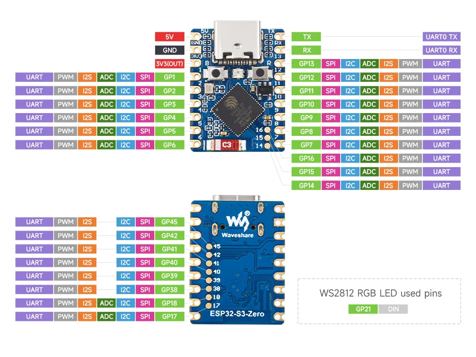

# Хардуерна спецификация

Компонентите на контролера и как се свързват. Базовата платка (кутия, клеми, захранване 230 V, реле) е описана в
[base-board.md](base-board.md), а настройките във фърмуера — в [firmware.md](firmware.md).

## 0. Обобщение

| Блок | Компонент | Захранване |
|---|---|---|
| Микроконтролер | Waveshare ESP32-S3-Zero | 5 V шина (вход 5V) |
| Индикация | Вграден RGB светодиод WS2812 (XL-0807RGBC-WS2812B) на ESP32-S3-Zero, GPIO21 | от платката |
| Изпълнителен елемент | Реле (5 V бобина) с транзистор и обратен диод — включва циркулационната помпа | 5 V шина |
| Температурни датчици | Бойлер: DS18B20 (водоустойчива сонда). Колектор: в разработката — DS18B20; в крайния вариант — **Pt1000 или NTC** (по избор) през АЦП **ADS1120** (виж т. 3.1) | DS18B20: VDD от 5 V шина, pull-up към 3.3 V (виж т. 3); ADS1120: 3.3 V |
| Локално управление | 3-цифрен 7-сегментен дисплей с драйвер TM1637 + 3 бутона | 5 V шина, pull-up на CLK/DIO към 3.3 V (виж т. 5) |

## 1. Микроконтролерна платка — Waveshare ESP32-S3-Zero

- **Чип:** ESP32-S3 (Xtensa LX7, двуядрен, Wi-Fi 2.4 GHz + Bluetooth LE) — както е на диаграмата
- **Конектор:** USB Type-C (захранване, програмиране, USB-Serial/JTAG)
- **Бутони:** `B` — BOOT (GPIO0), `R` — RESET
- **Вграден RGB светодиод:** WS2812 на **GPIO21** (DIN)

### Захранващи изводи

| Извод | Описание |
|---|---|
| 5V | Вход/изход 5 V (от USB) |
| GND | Маса |
| 3V3 (OUT) | Изход 3.3 V от вградения регулатор ME6217C33M5G (LDO, макс. 800 mA — вкл. консумацията на самия ESP32-S3) |

Бюджет на 3.3 V: регулаторът е линеен (5 V → 3.3 V), в малък корпус SOT-23-5 — при 5 V вход загубата е
(5 − 3.3) V × I, т.е. ~0.5 W при 300 mA, което го нагрява силно. ESP32-S3 с Wi-Fi сам взима до ~350 mA пикове.
Затова **външните консуматори на 3.3 V се ограничават до няколко mA** — в проекта само pull-up резисторите
(~1 mA общо); датчиците, дисплеят и релето са на 5 V.

### GPIO извеждания

| Страна | Изводи | Функции (според pinout-а) |
|---|---|---|
| Лява (горе) | GP1 – GP6 | UART, PWM, I2S, **ADC**, I2C, SPI |
| Дясна (горе) | TX, RX | UART0 TX / RX (конзола) |
| Дясна (горе) | GP7 – GP13 | UART, PWM, I2S, **ADC**, I2C, SPI |
| Дясна (долу) | GP14 – GP16 | UART, PWM, I2S, **ADC**, I2C, SPI |
| Долна страна (пад) | GP17, GP18 | UART, PWM, I2S, **ADC**, I2C, SPI |
| Долна страна (пад) | GP38 – GP42, GP45 | UART, PWM, I2S, I2C, SPI (без ADC) |

Бележки:
- Аналогови входове (ADC) има само на GP1 – GP18 — важно за датчици за температура (NTC и др.).
- GP0 е BOOT бутонът; GP21 е зает от вградения RGB светодиод.
- GP45 е strapping извод на ESP32-S3 (избор на напрежение на VDD_SPI) — да се използва внимателно.
- GP19/GP20 са USB D-/D+ и не са изведени.
- Изводите GP17, GP18, GP38–GP42, GP45 са малки пад-ове от долната страна на платката — **в проекта не се използват**;
  ползват се само страничните изводи GP1 – GP13, на които се запояват проводници.

## 2. Вграден RGB светодиод — XINGLIGHT XL-0807RGBC-WS2812B

Datasheet: [`XL-0807RGBC-WS2812B.pdf`](XL-0807RGBC-WS2812B.pdf)

- Адресируем RGB светодиод с вграден драйвер, протокол WS2812 (еднопроводен, return-to-zero код).
- Корпус 0807 (2.0 × 1.8 × 0.8 mm).
- След подаване на захранване по подразбиране е **изгаснал**.

| Параметър | Стойност |
|---|---|
| Захранващо напрежение VDD | 3.5 – 5.5 V (типично 5.0 V) |
| Логически вход VIH / VIL | ≥ 0.7·VDD / ≤ 0.3·VDD |
| Ток на канал (R/G/B) | 1.75 – 19 mA, 16 стъпки (по подразбиране 19 mA) |
| Статичен ток (изгаснал) | ~2.5 mA |
| PWM честота | 4 kHz |
| Светлинен интензитет @20 mA | R 200 / G 800 / B 300 mcd |
| Дължина на вълната | R 620–630 / G 520–530 / B 465–475 nm |
| Ъгъл на излъчване | 120° |
| Работна температура | -40 … +150 °C |

### Използване в проекта

- Използва се **вграденият светодиод на ESP32-S3-Zero така, както е** (GPIO21).
  Захранването, кондензаторът и връзката с чипа са решени на самата платка — **без допълнителни елементи**
  (без външен светодиод и без преобразувател на ниво).
- Приложение: индикация на състоянието на контролера (Wi-Fi, HomeKit сдвояване, работа на помпата, грешки на датчиците, OTA) —
  виж [led-indication.md](led-indication.md).
- Datasheet-ът е само за светодиода; в източника (Waveshare wiki) е публикуван към страницата на ESP32-C3-Zero, но светодиодът е същият.

Драйвер и настройки във фърмуера: виж [firmware.md](firmware.md#22-rgb-светодиод-ws2812).

## 3. Температурни датчици — 2 × DS18B20

Модел: водоустойчива сонда DS18B20 ([vactor.bg, VAC3011](https://vactor.bg/product/temperature-sensor-for-arduino/))

Datasheet: [`DS18B20.pdf`](DS18B20.pdf) (Maxim/Analog Devices, 19-7487 Rev 6, 7/19)

| Параметър | Стойност |
|---|---|
| Интерфейс | Digital 1-Wire |
| Захранване | 3.0 – 5.5 V |
| Консумация | 1 – 1.5 mA |
| Обхват | -55 … +125 °C |
| Точност | ±0.5 °C (-10 … +85 °C) |
| Точност (разширена) | ±1 °C (-30 … +100 °C), ±2 °C (-55 … +125 °C) |
| Резолюция | 9 – 12 бита (0.5 … 0.0625 °C), настройва се |
| Време за преобразуване | 93.75 / 187.5 / 375 / **750 ms** (9 / 10 / 11 / 12 бита) |
| Логически нива (локално захранване) | VIL ≤ 0.8 V, VIH ≥ **2.2 V** |
| Pull-up напрежение VPU (локално захранване) | 3.0 V … VDD |
| Ток в покой | 750 – 1000 nA |
| Уникален адрес | 64-битов ROM код (позволява няколко датчика на една шина) |
| Енергонезависима памет | Аларми TH/TL и конфигурация в EEPROM (≥ 50k записа) |
| Корпус | Неръждаема стомана, Ø5 × 50 mm |
| Кабел | 3 жила, 95 cm |

Цветове на жилата:

| Жило | Сигнал |
|---|---|
| Червено | VCC |
| Черно (или зелено) | GND |
| Жълто (или бяло) | DATA |

Бележки за свързване:
- Изисква се **pull-up резистор 4.7 kΩ** между DATA и VCC (продавачът дава 4.7 – 10 kΩ; при дълъг кабел — по-ниска стойност).
- ⚠️ Изводите на ESP32-S3 **не са 5 V толерантни** — pull-up резисторът задължително е към **3.3 V**.
- **VDD на датчиците е от 5 V шината, pull-up резисторът е към 3.3 V.**
  Причина: 3.3 V шината захранва ESP32-S3 (вкл. радиочастотната част на Wi-Fi) — не се извежда по дълги кабели,
  за да не се внасят в нея смущения и импулси от външните линии.
  Datasheet-ът го допуска: при локално захранване VIH ≥ 2.2 V и VPU = 3.0 V … VDD.
- **Защита на DATA линията** (кабелите са дълги и изнесени, а в същия кабел има 5 V — при повреда/влага жилата VCC
  и DATA може да се окъсят):
  - последователен резистор ~100 – 220 Ω между GPIO и линията (pull-up-ът е от страната на кабела/конектора);
  - ограничителен диод към 3.3 V и GND (напр. двоен Шотки BAT54S) или TVS/ESD диод при конектора.
- **Филтър на 5 V към датчиците:** ферит или малък резистор (~10 – 47 Ω) последователно и кондензатор 100 nF при конектора,
  за да не се връщат смущения от кабелите към 5 V шината; по избор — самовъзстановяващ се предпазител (PTC).
- Да се използва локално захранване (3 проводника), а не паразитно — паразитното изисква силен pull-up по време на преобразуване.
- **Всеки датчик е на отделен GPIO** (отделна 1-Wire шина) със собствен pull-up 4.7 kΩ.
  Предимства: ролята на датчика се определя от извода (не е нужно да се запомнят ROM адреси), подмяна без пренастройка,
  повреда на единия датчик/кабел не блокира другите.
- Изводи: T_COL → **GP1**, T_TANK → **GP2** (страничният ред до 3V3/GND — удобно за запояване и за pull-up резисторите).

### Разположение и роли

| Датчик | Място | Статус |
|---|---|---|
| T_COL | Соларен колектор | задължителен |
| T_TANK | Бойлер (първо гнездо) | задължителен |

**Датчиците са точно 2** (ограничение от броя клеми в DIN кутията — 6 клеми = 2 × 3 жила).

### 3.1 Датчик на колектора — DS18B20, Pt1000 или NTC

Колекторът в стагнация минава 130 °C, а DS18B20 мери до 125 °C. Затова датчикът на колектора може да е и
**Pt1000 или NTC**, измерван с външен АЦП **ADS1120**. **DS18B20 на колектора остава като възможност** (сегашната
разработка и тестовете ѝ не се променят) — за инсталации, в които колекторът не стига над ~120 °C. Бойлерът е винаги
с DS18B20 (0 – 100 °C — точен, цифров, без калибриране). Datasheet-ове: [ADS1120.pdf](ADS1120.pdf),
[ADS1220.pdf](ADS1220.pdf).

**Изисквания към измерването:**

| Параметър | Стойност |
|---|---|
| Сензор | Pt1000 клас A (3-проводно; поддръжка и на 2-проводно — виж по-долу) или NTC |
| Обхват | −40 … +200 °C (при NTC — по-ниска горна граница) |
| Точност | ±0.5 °C (допустимо до ±1 °C) |
| Показване и запис | 0.1 °C |
| Кабел | дълъг — над 40 m (напр. 0.75 mm²) |
| Захранване на АЦП | 3.3 V |
| Цикъл на отчитане | 10 s |

**Избор на вида** — настройка в менюто (`SEn`: `dS1` / `Pt1` / `NtC`) и в уеб интерфейса („Сензор за колектор“:
DS18B20 / Pt1000 / NTC); по подразбиране — DS18B20 — [operating-modes.md](operating-modes.md), т. 1.3 и 6.1.

#### Защо ADS1120

- 16-битов делта-сигма АЦП, SPI, 4 аналогови входа, PGA 1 – 128, захранване 2.3 – 5.5 V, корпус TSSOP-16.
- Два съгласувани източника на ток (IDAC) — 3-проводна схема с компенсация на кабела в едно измерване.
- Вход за външен референтен сигнал — **ратиометрично** измерване: точността не зависи от абсолютната стойност на
  тока (IDAC имат ±6 % абсолютна точност, но ±0.3 % съгласуване помежду си).
- Едновременно потискане на 50 Hz и 60 Hz при 20 SPS.
- Резолюция без шум 16 бита при 20 SPS → стъпка ~0.016 °C за Pt1000, 5 пъти по-фина от показваната 0.1 °C.
- **ADS1220** — съвместим по изводи и регистри, със същото аналогово ядро; ~2 бита повече резолюция без шум, но не
  по-добра абсолютна точност — при показване до 0.1 °C не носи полза. Има и ток на възбуждане 10 µA, който
  ADS1120 няма (при него най-малкият е 50 µA).
- **MAX31865** не е избран: един канал на чип, само 3.0 – 3.6 V, грешка до ±0.5 °C само от преобразувателя, един
  производител; вградената защита ±45 V е за постоянно напрежение и не замества TVS защитата при дълъг кабел.

#### Pt1000, 3-проводно — схемата

Двата IDAC, референтният резистор Rref откъм земята:

| Извод на ADS1120 | Свързване |
|---|---|
| AIN0 | IDAC1 → жило 1 (към горния извод на сензора) |
| AIN1 | измервателен вход (+) → жило 1, през RC филтър |
| AIN2 | измервателен вход (−) → жило 2, през RC филтър |
| AIN3 | IDAC2 → жило 2 (към долния извод на сензора) |
| REFP0 | горният край на Rref (свързан с жило 3) |
| REFN0 | долният край на Rref (AVSS / GND) |

Жила 2 и 3 са свързани към един и същ извод на сензора. Токовете на двата IDAC протичат заедно през жило 3 и Rref.
Разликата V(AIN1) − V(AIN2) = I·R_RTD + I·(R_жило1 − R_жило2): при еднакви жила съпротивлението на кабела се
компенсира. IDAC се подават на отделни изводи (AIN0, AIN3), за да не протичат през резисторите на RC филтъра на
измервателните входове.

| Елемент | Стойност | Бележка |
|---|---|---|
| IDAC1, IDAC2 | 2 × 250 µA | самонагряване ~0.11 mW при 200 °C |
| Rref | 2.00 kΩ, 0.1 %, ≤ 10 – 25 ppm/°C | референтен сигнал 2 × 250 µA × 2 kΩ = 1.0 V |
| Усилване (PGA) | 2 | обхват 2 × 1760 Ω = 3520 Ω < 2 × Rref = 4000 Ω (~12 % запас) |
| Напрежение на IDAC1 | ~1.45 V | голям запас до границата AVDD − 0.9 V = 2.4 V |

**Защита на входовете (кабел над 40 m):**
- TVS диод с ниска утечка на всяко жило към GND; утечката да се провери при максималната работна температура — при
  250 µA утечка от 1 µA е 0.4 % грешка.
- Последователни резистори и RC филтър на AIN1 / AIN2 — по тях практически не тече ток и не внасят грешка.
- Малък последователен резистор (до ~1 kΩ) на изводите на IDAC (AIN0 / AIN3) — падът от 0.25 V при 250 µA се
  побира в запаса на IDAC.
- Екраниран кабел, екранът — заземен само откъм платката; снадките по кабела — в херметична кутия, кримпвани или
  запоени и защитени от влага.

**Регистри** (да се сверят с регистровата карта в datasheet-а преди първото включване):

| Регистър | Стойност | Съдържание |
|---|---|---|
| 0x00 | 0x32 | MUX = AIN1 – AIN2, GAIN = 2, PGA включен |
| 0x01 | 0x00 | 20 SPS, нормален режим, единично преобразуване, без температурния сензор, без източника за откриване на прекъсване |
| 0x02 | 0x54 | външен референтен сигнал REFP0 / REFN0, потискане на 50 и 60 Hz, IDAC = 250 µA |
| 0x03 | 0x30 | IDAC1 → AIN0, IDAC2 → AIN3 |

**Цикъл на измерване (на всеки 10 s):**
1. IDAC остават постоянно включени (не се чака установяване на RC филтъра).
2. 5 измервания за ~2 s, всяко с команда START/SYNC (~60 ms при 20 SPS).
3. Проверка на всяко: код +32767 или −32768 → прекъснат или късо съединен сензор / жило; R извън 750 – 1900 Ω →
   грешка; невалидните се отхвърлят.
4. Медиана от валидните; при по-малко от 3 валидни — грешка вместо температура.
5. Код → съпротивление → калибрационна корекция → температура.
6. Закръгляне до 0.1 °C с хистерезис ±0.05 °C за дисплея; записът може да е без хистерезис.

По желание веднъж в минута — отделно измерване с включен източник на ток за откриване на прекъсване (бит BCS); само
за диагностика, резултатът се изхвърля.

**Формули:**
- Код → съпротивление: `R = код / 32768 × 2 × Rref / Gain = код × 2000 / 32768` [Ω] (Rref = 2000 Ω, Gain = 2).
- Калибрационна корекция: `R_корр = k × R + b`.
- Съпротивление → температура — Callendar–Van Dusen (IEC 60751): R0 = 1000 Ω, A = 3.9083e-3, B = −5.775e-7,
  C = −4.183e-12 (само за t < 0 °C).
  - R ≥ 1000 Ω (t ≥ 0 °C) — затворена формула `t = (−A + √(A² − 4·B·(1 − R/R0))) / (2·B)`; напр. R = 1177 Ω →
    t ≈ 45.6 °C.
  - R < 1000 Ω (t < 0 °C) — итерация на Нютон (2 – 3 стъпки) по `f(t) = R0·[1 + A·t + B·t² + C·(t − 100)·t³] − R`,
    `f'(t) = R0·[A + 2·B·t + C·(4·t³ − 300·t²)]`, `t(n+1) = t(n) − f(t(n)) / f'(t(n))`; началната стойност — от
    затворената формула.

**Калибриране при производство:** на входните клеми се свързват последователно два прецизни резистора (0.01 %),
напр. R1 = 1000.0 Ω и R2 = 1700.0 Ω, в 3-проводна конфигурация; измерват се Rm1 и Rm2 (медиана от няколко
измервания); `k = (R2 − R1) / (Rm2 − Rm1)`, `b = R1 − k × Rm1`; k и b се записват в NVS. Калибрирането компенсира
началния допуск на Rref и грешката на усилването на PGA — затова Rref с допуск 0.1 % е достатъчен; важен остава
температурният му коефициент.

**Очаквана точност:**

| Източник | Принос |
|---|---|
| Сензор Pt1000 клас A | ±(0.15 + 0.002·\|t\|) °C → ±0.55 °C при 200 °C |
| ADS1120 (стъпка без шум) | ~0.016 °C |
| Rref след калибриране (дрейф 10 ppm/°C, ±30 °C) | ~0.1 °C при 200 °C |
| Съгласуване на IDAC (компенсация на кабела) | < 0.01 °C |
| Кабел 40 m, 0.75 mm² (3-проводно) | компенсира се |

Доминира грешката на сензора: за ±0.5 °C в целия обхват е нужен сензор клас A или по-добър, или калибриране на
сензора.

#### Pt1000, 2-проводно

Съществуващи инсталации често са с 2-проводно опроводяване. Двете жила се свързват към клеми 10 и 12, клема 11
остава свободна. **Фърмуерът го разпознава сам:** при свободна клема 11 източникът на ток към нея (IDAC2) няма път и
напрежението там стига горната си граница; тогава фърмуерът затваря ключа **S2** (свързва клема 11 с клема 12 в
платката — вместо мостче), пренасочва двата IDAC към клема 10 (общо 500 µA; референтният сигнал остава 1.0 V —
ADS1120 иска поне 0.75 V) и показва в „Сервизни“ „Pt1000, 2-проводно — засечено“. През S2 не тече ток, затова
съпротивлението му не влиза в измерването.

Измерената стойност включва съпротивлението и на двете жила: при 40 m, 0.75 mm² мед — ~1.8 Ω, т.е. ~+0.5 °C
(Pt1000 се мени с ~3.9 Ω/°C). Грешката се премахва с **корекция за кабела** в „Сервизни“ — въведено съпротивление
(или дължина и сечение) или еднократно измерване с дадено накъсо място на сензора.

#### NTC (предложение — за решаване)

- **Обхват на съпротивлението.** Масовият NTC 10 kΩ (B ≈ 3950) има ~400 kΩ при −40 °C, ~105 kΩ при −20 °C, 10 kΩ при
  25 °C, ~700 Ω при 100 °C, ~200 Ω при 150 °C и ~75 Ω при 200 °C — над 5000 пъти, срещу ~2 пъти при Pt1000
  (~840 – 1760 Ω). Ратиометричната схема на Pt1000 (IDAC + Rref) покрива само до ~2 kΩ.
- **IDAC не стигат за студения край.** Най-малкият ток на ADS1120 е 50 µA, а напрежението на IDAC е до AVDD − 0.9 V
  = 2.4 V → най-много ~48 kΩ → NTC 10k се мери само над около −5 °C. За защитата от замръзване това не стига.
- **Затова NTC — с делител:** прецизен резистор (напр. 10 kΩ, 0.1 %) от AVDD към NTC, измерване спрямо AVDD като
  референтен сигнал (ратиометрично; PGA изключен, усилване 1 – 4). Покрива −40 … 200 °C с достатъчна резолюция
  (~0.06 °C на стъпка при 200 °C, по-фино при по-ниски температури).
- **Една и съща клема за двата вида:** резисторът на делителя Rs (10 kΩ, 0.1 %, ≤ 25 ppm/°C) се включва към клема
  10 с ключа **S1** само при NTC — иначе пречи на измерването на Pt1000. При NTC IDAC са изключени, референтният
  сигнал е AVDD (ратиометрично), измерва се клема 10 спрямо земята (PGA изключен, усилване 1 – 4); веригата е
  AVDD → Rs → S1 → NTC → Rref → GND (Rref участва с известната си стойност).
- **Кабелът:** NTC е 2-проводен; ~1.8 Ω при 40 m, 0.75 mm² дават ~0.4 °C грешка при 150 °C и ~1.4 °C при 200 °C (NTC
  10k там се мени само с ~4.4 / ~1.3 Ω/°C).
- **Утечката на TVS** има значение при студения край (стотици kΩ) — нужни са диоди с много ниска утечка.
- **Таблицата R–T** (или коефициентите Steinhart–Hart) на избрания NTC от производителя — за точното превръщане в
  температура.
- **Горна граница при NTC — 125 °C** (както при Delta). Така се ползват стандартните NTC (масовите NTC 10 kΩ,
  B ≈ 3435 / 3950, със сонди до 105 °C с PVC кабел или до 150 °C със силиконов). Над нея стойността се приема за
  „над обхвата“.
- **Точността на NTC** зависи най-вече от самия датчик: при допуск 1 % на B и на R25 грешката е ~±0.5 °C при −20 °C,
  ~±1.5 °C при 125 °C (и расте с температурата). Студеният край е точен, горещият — по-малко.
- **Праговете при NTC:** при избор на NTC потребителят се предупреждава, че измерването е с по-голяма
  грешка, а защитите се задействат при стойности, при които измерването е надеждно — по-ниска стойност от
  изчислената за защитата на колектора (и за праговете, свързани с точката на кипене), по-висока — за защитата от
  замръзване (напр. антифриз до −30 °C, а надеждно измерване до −5 °C → защитата при −5 °C). Конкретните граници на
  надеждния обхват — с избрания NTC и схемата.

#### Изводи на ESP32-S3 и захранване

Хардуерният SPI (FSPI), изводите му по подразбиране, един до друг на дясната страна:

| ADS1120 | ESP32-S3-Zero | Бележка |
|---|---|---|
| CS | GP10 | |
| DIN | GP11 | |
| SCLK | GP12 | |
| DOUT/DRDY | GP13 | |
| DRDY | GP14 | по избор (готовността може да се чете и от DOUT/DRDY) |
| CLK | — | към DGND (вътрешен такт) |

- Няма конфликт с досегашните изводи: GP1 остава за DS18B20 на колектора (при избор DS18B20), ADS1120 е на GP10 –
  GP14; ключовете S1 / S2 — на GP15 / GP16. Свободен остава само GP3 (strapping извод — по-добре незает).
- Захранване 3.3 V; консумацията (ADS1120 и двата IDAC по 250 µA) е под 1.5 mA.
- **Клеми 10 – 12 в крайния вариант** — входът на Pt1000 / NTC:

  | Клема | Pt1000, 3-проводно | Pt1000, 2-проводно | NTC |
  |---|---|---|---|
  | 10 | жило 1 | жило 1 | жило 1 |
  | 11 | жило 2 | свободна | свободна |
  | 12 | жило 3 | жило 2 | жило 2 |

  | Режим | S1 | S2 | Ток на възбуждане | Референтен сигнал | Измерване |
  |---|---|---|---|---|---|
  | Pt1000, 3-проводно | отв. | отв. | 2 × 250 µA (IDAC1 → 10, IDAC2 → 11) | Rref, 1.0 V | 10 − 11, кабелът се компенсира |
  | Pt1000, 2-проводно (засича се) | отв. | затв. | двата IDAC → 10, общо 500 µA | Rref, 1.0 V | 10 − 11 (= 12 през S2), корекция за кабела |
  | NTC | затв. | отв. | изключени | AVDD | 10 спрямо земята; делител Rs → NTC → Rref |

  В крайния вариант на тези клеми няма захранване 5 V, затова **DS18B20 на колектора работи само на прототипа**
  (`dS1` остава във фърмуера като възможност).
- **Ключовете S1 и S2** — два аналогови ключа (SPST, нормално отворени) на платката, управлявани от **GP15** (S1) и
  **GP16** (S2); при включване и рестарт са отворени (pull-down ~100 kΩ на управлението — GPIO на ESP32 е във висок
  импеданс, докато фърмуерът не го настрои). Изисквания:

  | Изискване | Стойност | Защо |
  |---|---|---|
  | Вид | SPST, нормално отворен (NO); два в един корпус или два единични | — |
  | Захранване / логика | 3.3 V (от AVDD на ADS1120), логическите входове — 3.3 V от GPIO | същото захранване като ADS1120 |
  | Обхват на сигнала | 0 … 3.3 V (rail-to-rail) | S1 вижда до AVDD, S2 — ~1 – 2 V |
  | Утечка (отворен) | ≤ 1 nA (типично pA), и при 85 °C | при NTC в студения край (стотици kΩ) и при Pt1000 — да не внася грешка |
  | Съпротивление (затворен) | S1 — ≤ ~10 Ω (последователно на 10 kΩ → ≤ 0.1 %, остатъкът се калибрира); S2 — без значение (през него не тече ток) | точност при NTC |
  | Температурен обхват | −40 … +85 °C | кутията в таблото |
  | Корпус | малък (SOT-23 / SC-70) | място в DIN кутията |

  Скоростта, инжектираният заряд и изолацията при високи честоти нямат значение — ключовете се превключват рядко
  (при смяна на настройката или засичане). Ключовете са зад TVS диодите и последователните резистори на входа, за
  да са защитени от импулсите по кабела.

  **Избран: 2 × Texas Instruments TMUX1101** (по един за S1 и S2; datasheet — [TMUX1101.pdf](TMUX1101.pdf)). При
  захранване 3.3 V: утечка в отворено състояние 0.001 nA типично, ≤ 0.2 nA при 85 °C; съпротивление в затворено
  състояние 3.7 Ω типично, ≤ 9.5 Ω при 85 °C; управление с активно високо ниво (нормално отворен), съвместимо с 1.8 V
  логика, входът понася до 5.5 V и без захранване (fail-safe); корпус SC70-5 или SOT-23-5. TMUX1102 е същият, но
  с обратна логика — не се ползва. 74LVC1G66 не е подходящ: утечката му е до 0.2 µA при 85 °C (~1000 пъти повече) —
  внася грешка при NTC в студения край.

## 4. Реле

- **Товар:** циркулационната помпа на соларния кръг.
- Бобина 5 V, захранвана от 5 V шината.
- **Управление:** GPIO → базов резистор → NPN транзистор (или N-MOSFET) в ниския край на бобината.
- **Обратен (flyback) диод** паралелно на бобината (катод към +5 V) — поглъща индуктивния импулс при изключване.
- Препоръка: pull-down резистор на базата/гейта, за да е релето изключено при рестарт на ESP32 (докато GPIO е в high-Z).
- Контактите на релето да са оразмерени за пусковия ток на помпата (индуктивен товар, обикновено 230 V AC).
- По избор: RC снъбер или варистор на контактите — намалява искренето и смущенията при изключване на помпата.
- Модел на помпата и консумация — предстоят.

## 5. Локално управление — дисплей и бутони

Контролерът трябва да може да се наблюдава и настройва и без телефон: малък дисплей и 3 бутона на лицевия панел.

### 5.1 Дисплей — 7-сегментни цифри с TM1637

- Драйвер **TM1637** (Titan Micro): управлява до 6 цифри × 8 сегмента (с точка), вграден мултиплекс,
  8 нива на яркост, двупроводен сериен интерфейс (CLK, DIO) — подобен на I2C, но **без адреси** (не е I2C).
- **3 цифри** — събират се в лицевия панел и стигат за температури до 150 °C.
- Налични индикатори (3-цифрени, по 8 сегмента с точка):

  | Модел | Бележка |
  |---|---|
  | ARKLED SP610281B | общ анод — **проверено** |
  | KYX-3361BG (по надписа) | общ анод — **проверено** |

  ⚠️ TM1637 работи само с индикатори с **общ анод** (GRID изводите подават ток към общия анод на цифрата,
  SEG изводите го поемат от сегментите). И двата налични модела са проверени с уред — общ анод.
  Двата модела най-вероятно са с различно разположение на изводите — за платката се избира един от тях
  (или се предвижда отпечатък за двата).
- Изводи към ESP32-S3: **CLK → GP5, DIO → GP6**.
- Библиотека: [esp_tm1637](https://github.com/AramVartanyan/esp_tm1637) (собствена; бележки за обновяване — в [firmware.md](firmware.md#23-дисплей-tm1637-и-бутони)).
- Datasheet: Titan Micro TM1637 V2.4 — [в хранилището на библиотеката](https://github.com/AramVartanyan/esp_tm1637/blob/main/pictures/Datasheet_TM1637.pdf).

Данни от datasheet-а:

| Параметър | Стойност |
|---|---|
| Захранване VDD | **5 V** (типично); характеристиките са дадени за **4.5 – 5.5 V** |
| Логически нива CLK / DIO | VIH ≥ **0.7·VDD** (3.5 V при 5 V), VIL ≤ 0.3·VDD |
| DIO | двупосочен: TM1637 потвърждава всеки байт (ACK), като дърпа DIO към GND |
| Ток на сегмент (SEG, sink) | 20 – 50 mA (типично 30 mA) |
| Ток на разряд (GRID, source) | 80 – 200 mA |
| Собствена консумация (дисплей изключен) | ≤ 5 mA |
| Клавиатура | 8 × 2, K1/K2 с вътрешни 10 kΩ към GND; **без комбинации от бутони** |
| Препоръки | филтриращ кондензатор до VDD; 100 pF на CLK и DIO срещу смущения |

Захранване и нива:
- **TM1637 се захранва от 5 V, управлението (CLK, DIO) е директно от ESP32-S3 с 3.3 V нива — без преобразувател.**
  Захранване от 3.3 V отпада: 3.3 V регулаторът на ESP32-S3-Zero не е достатъчно мощен за дисплея (и захранва Wi-Fi).
  Проверено на практика: TM1637 работи надеждно с 3.3 V сигнали при VDD = 5 V
  (формално datasheet-ът дава VIH = 0.7·VDD = 3.5 V, но реално това не е проблем).
- **Pull-up резисторите на CLK и DIO (10 kΩ) — към 3.3 V.** TM1637 само дърпа DIO към GND (ACK) и никога не го
  дърпа към VDD, така че на изводите на ESP32-S3 не може да се появи 5 V.
- Вътрешните pull-up резистори на ESP32-S3 (~45 kΩ) са твърде слаби:
  при капацитет на линията ~50 – 100 pF фронтът е ~2 – 5 µs, колкото е и закъснението в библиотеката (3 µs).
  Затова се използват **външни 10 kΩ към 3.3 V**; вътрешните остават изключени (или само като допълнение).
- ⚠️ **Готовите модули с TM1637 често имат собствени pull-up резистори (~10 kΩ) към VCC на модула.**
  Те се **преместват към 3.3 V** (при VCC = 5 V подават 5 V към изводите на ESP32-S3).
- Кондензатори 100 pF на CLK/DIO към GND (препоръка от datasheet-а) — **допустими**: с тази библиотека и ESP32 дисплеят
  работи и с тях (10 kΩ × 100 pF ≈ 1 µs, при стъпка 3 µs в библиотеката). Предвиждат се като позиции по избор.
- ⚠️ Pull-up към 5 V **не е допустим**: при пусната линия (DIO е вход по време на ACK) pull-up-ът вдига извода до 5 V,
  а изводите на ESP32-S3 не са 5 V толерантни (максимум ~3.6 V) — токът тече през защитните диоди към 3.3 V шината.
- Интерфейсът прилича на I2C (старт/стоп, ACK след всеки байт), но не е I2C: няма адрес, битовете са с LSB първи.
- Ток: 3 – 4 цифри при мултиплексиране — средно ~ 20 – 40 mA според яркостта (от 5 V шината).
- Кондензатори при TM1637: 100 nF + 10 µF между VDD и GND.

С 3 цифри температурите до 150 °C се показват директно.

### 5.1.1 Свързване TM1637 ↔ 3-цифрен индикатор (проверена схема)

Индикатор с 12 извода (стандартно разположение за 3-цифрени 0.36", общ анод; извод 6 не се използва):

| TM1637 | Извод на индикатора | Сигнал |
|---|---|---|
| SEG1 (2) | 11 | A |
| SEG2 (3) | 7 | B |
| SEG3 (4) | 4 | C |
| SEG4 (5) | 2 | D |
| SEG5 (6) | 1 | E |
| SEG6 (7) | 10 | F |
| SEG7 (8) | 5 | G |
| SEG8 (9) | 3 | DP |
| GRID1 (15) | 12 | DIG1 (лява цифра) |
| GRID2 (14) | 9 | DIG2 |
| GRID3 (13) | 8 | DIG3 (дясна цифра) |
| GRID4 – GRID6 (12, 11, 10), K1, K2 (19, 20) | — | не се свързват |
| VDD (16) / GND (1) | — | +5 V / GND, 100 nF + 10 µF до чипа |
| CLK (18) / DIO (17) | — | към GP5 / GP6, 10 kΩ pull-up към **3.3 V**, по избор 100 pF към GND |

Разпределението съвпада с библиотеката `esp_tm1637`: бит 0…7 на байта = A…G, DP (SEG1…SEG8),
адрес 0 = GRID1 = лявата цифра — за 3 цифри не е нужно пренареждане на позициите.

### 5.2 Бутони (3 бр.)

TM1637 има вграден скенер за клавиатура (до 16 бутона, матрица 8 × 2 върху сегментните линии), но:
- чете **само един натиснат бутон** наведнъж — без комбинации (напр. два бутона за нулиране);
- няма извод за прекъсване — бутоните трябва да се питат периодично по серийната линия;
- бутоните споделят сегментните линии на дисплея.

Затова **бутоните са на отделни GPIO на ESP32-S3**, не на TM1637:
- свободни изводи има достатъчно (GP7 – GP13);
- работят и при повреда/липса на дисплея (важно за ръчно управление на помпата);
- позволяват дълго натискане, автоматично повторение и комбинации;
- библиотеката `button` (подобрената Espressif iot button) вече поддържа кратко/дълго натискане и
  автоматично повторение (`iot_button_set_serial_cb`) — удобно за „+ / −“ при настройки.

| Бутон | GPIO | Функция |
|---|---|---|
| BTN1 | GP7 | „меню“ — влиза в менюто, отваря и потвърждава стойност; задържане 5 s / 9 s — нулиране на Wi-Fi / фабрично нулиране |
| BTN2 | GP8 | „−“ — предишен параметър / по-малка стойност |
| BTN3 | GP9 | „+“ — следващ параметър / по-голяма стойност; от нормалния екран — тест на помпата |

„+“ и „−“ заедно за 3 s заключват / отключват клавиатурата.

Свързване: бутон между GPIO и GND, вътрешен pull-up на ESP32-S3 (или външен 10 kΩ към 3.3 V),
по избор 100 nF към GND за филтриране; софтуерно подтискане на трептенето (debounce) — в библиотеката.
Менюто и всички функции на бутоните — в [operating-modes.md](operating-modes.md), т. 6.1.

